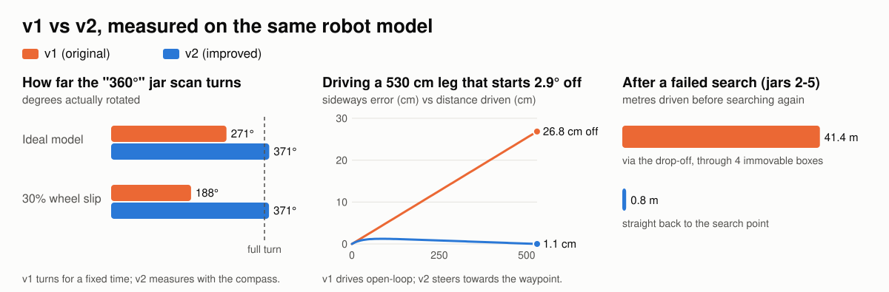
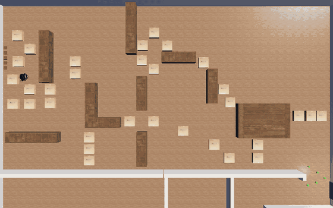
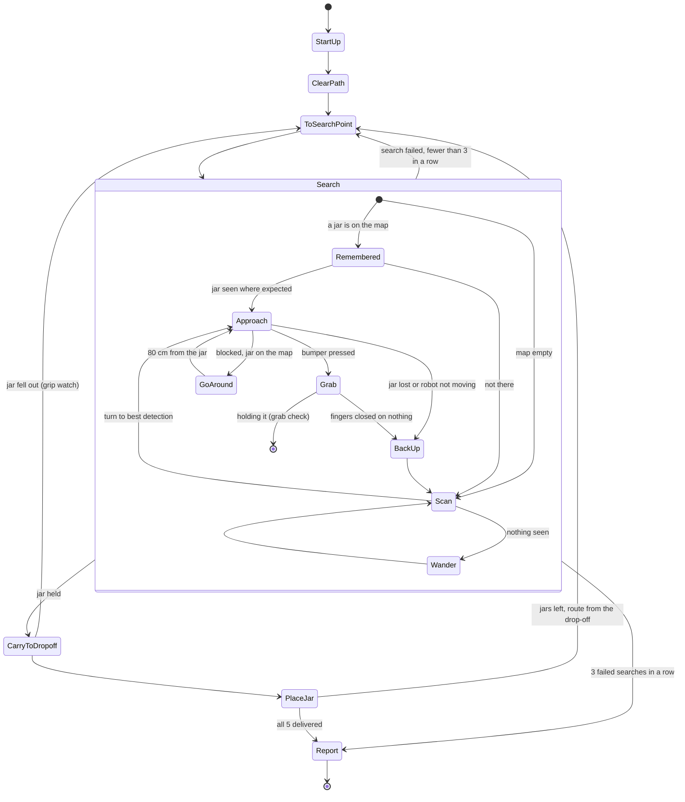
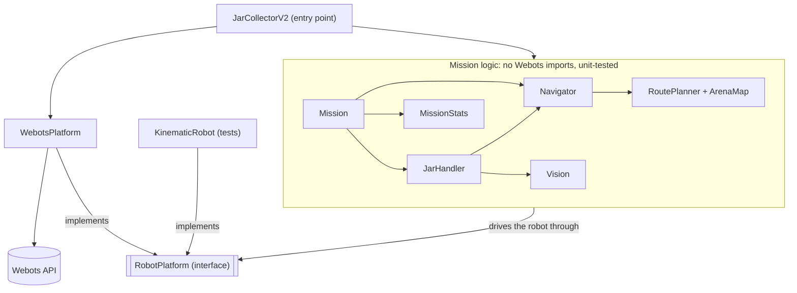

# 🤖 Autonomous Warehouse Robot: Webots Simulation

[](https://github.com/morganwhite13/Autonomous-Robot-Jar-Collection-System/actions/workflows/ci.yml)

An autonomous Pioneer 3-DX robot in **Webots** that clears a path through a 20 × 20 m warehouse, finds five honey jars with its camera, picks each one up with its gripper and delivers it to its own drop-off pad, with no human input.

**Tech stack:** Webots R2025a, Java, computer vision, robotics.

This repository holds **two versions side by side**:

| | |
|---|---|
| **v1: original** | The committed controller source, kept **byte-for-byte unchanged** in [`controllers/ProjectController3`](controllers/ProjectController3/ProjectController3.java). The repo also held an even older compiled version, v0; see [two controllers in one repo](docs/BEFORE_AND_AFTER.md#the-original-readme-vs-the-code). |
| **v2: improved** | Same routes, thresholds and gripper timings, restructured into testable classes with 9 bugs and 4 smaller issues fixed, in [`controllers/JarCollectorV2`](controllers/JarCollectorV2/) |

👉 **[Full before/after write-up](docs/BEFORE_AND_AFTER.md)**: each fix with the original line numbers, plus [measured results](docs/benchmark-results.md).

**Contents:** [Video demos](#-video-demos-original-project) · [Before and after](#️-before-and-after-at-a-glance) · [The mission](#️-the-mission) · [How it works](#️-how-it-works) · [Running it](#-running-it) · [Repository layout](#-repository-layout) · [What I learned](#-what-i-learned) · [Future improvements](#-future-improvements) · [License](#-license) · [Contact](#-contact)

---

## 📺 Video demos (original project)

- **[Main robot demo](https://www.youtube.com/watch?v=kO9e8dzjCfg)**: a full autonomous mission collecting the jars
- **[Top-down overview](https://www.youtube.com/watch?v=dIo8oXvvNeM)**: aerial view of navigation and collection
- **[Robot camera feed](https://www.youtube.com/watch?v=sPnMvLkUqaw)**: what the robot sees while it searches and approaches

---

## ⚖️ Before and after at a glance

<picture>
  <source media="(prefers-color-scheme: dark)" srcset="docs/images/before-after-dark.svg">
  
</picture>

| | v1 (before) | v2 (after) |
|---|---|---|
| **Whole mission in Webots** (real physics) | **0 of 5 jars delivered**. It aims at the floor and walls (its green test counts them), closes its gripper on nothing four times and counts each as a delivery, then gets stuck against a wall from 1204 s until the run is stopped | **All 5 delivered in 738 s** (12.3 min), with no stalls, timeouts or failed searches |
| **Six shuffled Webots worlds** (jars moved, start nudged) | **0 of 30 jars**, while claiming 22; stuck for good in 5 of 6 | **30 of 30**, every world finished in 721-765 s |
| Whole mission on the robot model | Never finishes on any of 20 robot variants (at most 2 of 5 jars delivered): it gets stuck turning back and forth, or drifts into a wooden box and pushes against it | Delivers all 5 on all 20 variants, in 728-822 s |
| After a failed search for jars 2-5 | Drives a 17.8 m straight line through 4 immovable wooden boxes | Returns 0.8 m to the search point |
| Something in the way | Pushes forever | Stops short on the sonars (or notices a stall in ~4 s), then plans a way around it with A* |
| "360°" jar scan | Covers ~271° (fixed 200 steps); 188° with wheel slip | Covers 370°, measured by the compass, with or without slip |
| Finding jars 2-5 | A full scan for every jar | Remembers where it saw jars: 2-3 scans in a whole mission |
| A far jar split between two thirds of the image | Stands still to "reassess", sees the same picture, and stands still again until the approach gives up | Steers towards the side with more green |
| Turn finishes (6,240 start/target pairs, kinematic model) | 91.7% at the ideal turn rate (can bounce across the ±3° window forever); 100% with slip | 100% in both |
| End of a 530 cm leg started 2.9° off | 26.8 cm from the waypoint | 1.1 cm |
| Longest approach before the time limit aborts it | ~58 cm (jars start 50-162 cm away) | Aborts only when not moving; ~176 cm cap |
| No jar can be found | Retries forever | Stops after 3 attempts with a report |
| Carrying a jar | Turns at full speed and lifts the jar 5 cm, so it flies or slips out in Webots, and the "delivery" still counts | Turns at a third of full speed with the jar 0.8 cm up; checks the grip, and notices within ~1 s if the jar falls out |
| Routes | Hand-tuned waypoints | A*-planned carry and return routes, about 14% shorter |
| Tests / CI | none | 181 JUnit tests covering 99% of v2's logic and catching 91% of injected bugs (mutation testing); SpotBugs clean (v1: 10 findings); GitHub Actions on JDK 11 and 21, plus v2's whole mission in Webots |
| Telemetry | Progress messages | Simulated-time log plus an end-of-run mission report |
| Repo opens in Webots | No: flat layout, missing robot protos, stale `.class` built from older code | Standard Webots project layout, with reconstructed robot protos included |

The Webots rows come from running both controllers headless in Webots R2025a, with one observer judging both ([results](docs/webots-results.md), [shuffled worlds](docs/webots-sweep.md), [what happened](docs/BEFORE_AND_AFTER.md#measured-in-webots)). The robot protos are reconstructions, because the originals were never committed. The other rows come from running ports of v1's methods and the real v2 classes on the same kinematic model of the robot.

### In Webots



v1 (orange) turns towards the floor and walls and makes four trips to the drop-off with an empty gripper. After a failed search it heads off along the route meant for the drop-off end, and ends up pressed against the wall at the far end of the jar bay. v2 (blue) clears the boxes, then makes five round trips and delivers every jar in 738 s. On v1's hand-tuned routes it takes 827 s. Getting there took fixes that only real physics could show, such as turning gently and carrying the jar low so it stays in the gripper ([bugs 11-14](docs/BEFORE_AND_AFTER.md#11-full-speed-turns-threw-the-jar-out-of-the-gripper-found-in-webots)).

<details>
<summary>v2 seen from above (GIF)</summary>



</details>

### On the robot model



A replay at 30x speed, on the robot model with motor lag and wheel slip. v1 never steers on a leg, so it drifts off its route while clearing boxes. At 47 s it drives into a wooden box and, with no stall detection, pushes against it for the rest of the run. v2 delivers all five jars. Generated from the same runs as the benchmark by `tools/MissionReplay.java`.

---

## 🗺️ The mission


*Generated from the world file and the controller's waypoints by [`tools/MapRenderer.java`](tools/MapRenderer.java). The unused southern half of the arena is cropped.*

1. **Clear the path**: follow a 15-waypoint route from the start, pushing cardboard boxes aside, and end at the search point outside the jar bay.
2. **Search**: rotate a full turn, scoring each camera frame by how many jar-green pixels it contains, with a bonus when they're in the centre third. Turn to the best heading.
3. **Approach and grab**: creep forward, steering towards whichever third of the image is clearly greenest, until the front bumper is pressed. Then close the gripper and lift.
4. **Deliver**: follow a 10-waypoint route to the drop-off lane, line up with that jar's pad (one per jar, 30 cm apart), release, back out.
5. **Repeat** from the drop-off for the remaining jars.

---

## 🏗️ How it works

### Simulated hardware

| Part | Used for |
|---|---|
| **Pioneer 3-DX** differential drive | Wheel speed up to 5 rad/s (≈0.49 m/s) |
| **Camera**, 64 × 64 RGB, 45° field of view | Finding and steering towards jars |
| **Compass** | Heading for every turn and for measuring the scan |
| **Touch sensor** (front bumper) | Knowing when a jar is between the gripper fingers |
| **Pioneer gripper** (lift motor and two finger motors) | Grabbing, lifting and releasing jars |
| **Supervisor API** | Ground-truth position for waypoint navigation |
| 6 sonar sensors | Start-up self-test. The two front ones also drive v2's sonar watch (`Config.SONAR_WATCH`), which slows down for obstacles on travel legs and stops short of them |

### Jar detection

A pixel counts as jar green when `R < 120`, `G > 35` and `B < 120` (v1's thresholds). v2 also requires green to beat red and blue by 10 so grey and brown pixels don't count. The frame is split into left / centre / right thirds (21 / 22 / 21 columns):

- **Scan score** = green pixels, **+50** if the centre third has the most.
- **Approach steering**: if one third leads both others by more than 10 pixels, turn towards it (inner wheel ×0.3, outer ×1.2). If the centre leads, or there are more than 30 green pixels, go straight. Otherwise v1 stops for 5 steps and looks again, which can repeat forever for a small, far jar split across two thirds. v2 steers towards the outer third with more green instead.
- **Speed**: v1 creeps at an eighth of full speed. v2 goes faster while the jar is more than 75 cm away, judging the distance from how low in the image the green reaches.
- **Give up** after 31 frames in a row with fewer than 15 green pixels.
- **Jar map (v2)**: during a 360° scan, v2 works out where each jar it sees is, from the lowest green row (distance) and the green's column (bearing), using the camera's measured height, offset and focal length. Later searches turn straight to the nearest mapped jar instead of scanning again.

### Mission flow (v2)

v1 had the same phases, but only implicitly, inside one long `main()`. v2 makes them explicit in [`Mission`](controllers/JarCollectorV2/Mission.java) and [`JarHandler`](controllers/JarCollectorV2/JarHandler.java), and every loop has an exit:



### Navigation (v2)

Each leg turns in place towards the waypoint, then drives to it:
- **Turn:** full speed until within 30° of the target, then proportional slow-down, stopping within ±3°. The error is computed safely across 0°/360°.
- **Drive:** full speed with a small proportional correction towards the waypoint, stopping once the robot has travelled the leg's length (v1's rule). On travel legs the front sonars slow it down for anything in the way and stop it 25 cm short.
- **Blocked:** if the robot moves less than 2 cm in 40 steps, or the sonars stop it, it backs off and assumes a 40 cm square just ahead is blocked. It then plans a way around that square and the walls and wooden boxes with A* ([`ArenaMap`](controllers/JarCollectorV2/ArenaMap.java), [`RoutePlanner`](controllers/JarCollectorV2/RoutePlanner.java)), and follows it.
- **Routes:** the carry and return routes are A*-planned, about 14% shorter than v1's hand-tuned waypoints with the same 30 cm clearance ([route planner](docs/route-planner.md)). v1's are still in [`Routes`](controllers/JarCollectorV2/Routes.java) (`Config.USE_PLANNED_ROUTES = false`).
- **Carrying:** turns at a third of full speed with the jar held 0.8 cm up, and watches the finger force so a jar that falls out is noticed within about a second.

### v2 code structure

Only `WebotsPlatform` talks to Webots. Everything else drives the robot through the `RobotPlatform` interface, which is what lets the tests swap in a simulated robot:



| Class | Responsibility |
|---|---|
| [`JarCollectorV2`](controllers/JarCollectorV2/JarCollectorV2.java) | Webots entry point |
| [`Mission`](controllers/JarCollectorV2/Mission.java) | The phase sequence, knows where the robot is, retry limit |
| [`Navigator`](controllers/JarCollectorV2/Navigator.java) | Turning, driving, stall detection, sonar watch, detours |
| [`RoutePlanner`](controllers/JarCollectorV2/RoutePlanner.java), [`ArenaMap`](controllers/JarCollectorV2/ArenaMap.java) | A* on a 5 cm grid, and the walls and wooden boxes it plans around |
| [`JarHandler`](controllers/JarCollectorV2/JarHandler.java) | Scan and jar map, approach, grab and grab check, place, grip watch |
| [`Vision`](controllers/JarCollectorV2/Vision.java) | Pixel classification, sector counts, steering decision (pure functions) |
| [`Routes`](controllers/JarCollectorV2/Routes.java) | All waypoints, defined once |
| [`Config`](controllers/JarCollectorV2/Config.java) | Every tunable number, each marked "v1" or "new" |
| [`RobotPlatform`](controllers/JarCollectorV2/RobotPlatform.java) / [`WebotsPlatform`](controllers/JarCollectorV2/WebotsPlatform.java) | The robot interface, and its Webots implementation (the only class that uses the Webots API) |
| [`MissionStats`](controllers/JarCollectorV2/MissionStats.java), [`Log`](controllers/JarCollectorV2/Log.java) | Telemetry and simulated-time logging |
| [`Angles`](controllers/JarCollectorV2/Angles.java), [`Vec2`](controllers/JarCollectorV2/Vec2.java), [`RgbImage`](controllers/JarCollectorV2/RgbImage.java) | Small value types and heading arithmetic |

Because the mission logic only talks to `RobotPlatform`, the tests can run it against [`KinematicRobot`](tests/KinematicRobot.java), a differential-drive model with a synthetic camera, without Webots.

At the end of every run v2 prints a report. This one is from the Webots run above:

```
==================== MISSION REPORT (v2) ====================
Result: 5/5 jars delivered in 735.5 s of simulated time

Time by phase (summed over all jars)
  Start-up                      1.3 s
  Clearing path                90.1 s
  Travel to search point      198.7 s
  Search and grab             114.9 s
  Carry to drop-off           283.5 s
  Place jar                    46.8 s

Jar   Time (s)  Scans  Approaches  Result
  1       88.7      1           1  delivered
  2      131.8      0           1  delivered
  3      136.3      0           1  delivered
  4      138.2      0           1  delivered
  5      149.1      1           1  delivered

Anomalies: drive stalls=0, drive timeouts=0, turn timeouts=0, failed searches=0, missed grabs=0, sonar stops=0, dropped jars=0, detours=0
==============================================================
```

Jars 2-4 needed no scan: v2 had mapped them during the first one. The controller's last delivery comes 2-3 s before the observer's, which waits for the jar to settle.

---

## 🚀 Running it

### Prerequisites
- **[Webots R2025a](https://cyberbotics.com/)**
- **JDK 11 or newer** on your `PATH`

The robot protos the world needs are included in `protos/`. They are reconstructed from Webots R2021b and run in Webots R2025a, which converts them on load. Keep their R2021b header; [`protos/README.md`](protos/README.md) explains why.

### In Webots
1. `git clone https://github.com/morganwhite13/Autonomous-Robot-Jar-Collection-System.git`
2. **Build the controllers.** Webots doesn't compile Java controllers on its own; with only the `.java` files it reports "Could not find controller file". Either run `WEBOTS_HOME=/usr/local/webots tools/build-controllers.sh` (macOS: `WEBOTS_HOME=/Applications/Webots.app`), or open each controller's main file in Webots' text editor and press **Build**.
3. **File → Open World** and choose:
   - `worlds/ProjectWorld2025.wbt` for **v1**, or
   - `worlds/ProjectWorld2025_v2.wbt` for **v2** (same world, different controller).
4. Press ▶. The console shows progress; v2 prefixes every line with the simulated time and ends with the mission report.

### Compare v1 and v2 in Webots automatically
```bash
WEBOTS_HOME=/usr/local/webots tools/run-in-webots.sh      # macOS: WEBOTS_HOME=/Applications/Webots.app
```
This runs both worlds without a window (using `xvfb-run` on Linux) and judges them the same way. An invisible observer supervisor, added only to temporary copies of the worlds, records the robot's path and the moment each jar comes to rest at the drop-off. It ends each run when all five are delivered, or after an hour of simulated time. The script then writes `docs/webots-results.md` (jars delivered, mission time, distance driven, aborted approaches, failed searches, stalls) and `docs/images/webots-paths.svg` (both driven paths on the arena map). Options:
- **`v2-hand-tuned`:** also runs v2 on v1's hand-tuned carry and return waypoints instead of its A*-planned routes: `tools/run-in-webots.sh v1 v2 v2-hand-tuned`.
- **`--set NAME=VALUE`:** changes one of v2's `Config` constants for the run, without touching the source, for example `--set SONAR_WATCH=false`.
- **`--seed N`:** shuffles the jars and nudges the start pose.
- **`--frames S`:** saves a top-down picture every S simulated seconds. `tools/make-demo-gif.sh` turns them into a GIF.
- **`--dry-run`:** builds and compiles everything without launching Webots.
- **`--watch v2`:** opens the Webots window and runs at real-time speed instead, for example to record a new demo video.

To check more than one layout, `tools/webots-sweep.sh --seeds 1-6 --jobs 3 v1 v2` runs both versions on six shuffled worlds, three at a time, and writes a summary like [`docs/webots-sweep.md`](docs/webots-sweep.md).

### Tests (no Webots needed)
```bash
tools/run-tests.sh
```
This compiles both controllers, runs the 181 JUnit tests, and regenerates [`docs/benchmark-results.md`](docs/benchmark-results.md) and both figures above. JUnit is downloaded on first run. To compile against your real Webots install instead of the bundled API stubs, set `WEBOTS_HOME`:

```bash
WEBOTS_HOME=/usr/local/webots tools/run-tests.sh
```

Add `--coverage` to measure line coverage of the v2 controller with JaCoCo. It's currently 99% of the logic, and 91% overall, since `WebotsPlatform` and the entry point only run inside Webots. The HTML report lands in `build/coverage/index.html`.

Coverage only shows which lines ran, not whether a test would notice if they were wrong. `tools/mutation-test.sh` checks that: [PIT](https://pitest.org/) makes hundreds of small changes to v2's logic (flips a comparison, drops a call, returns a constant) and reruns the tests against each one. Currently 91% of the changes make a test fail; CI requires at least 90%. The rest are reviewed in [BEFORE_AND_AFTER.md](docs/BEFORE_AND_AFTER.md#how-this-was-checked-and-what-still-needs-checking).

---

## 📁 Repository layout

```
worlds/
  ProjectWorld2025.wbt         v1 world (unchanged)
  ProjectWorld2025_v2.wbt      same world, runs the v2 controller
controllers/
  ProjectController3/          v1 controller (unchanged)
  JarCollectorV2/              v2 controller
protos/                        Pioneer 3-DX robot protos (reconstructed; see README inside)
tests/                         JUnit tests, kinematic robot model, ports of v1 methods
tools/
  run-tests.sh                 build + test + regenerate docs
  build-controllers.sh         compile both controllers so Webots can run them
  run-in-webots.sh             run v1 and v2 headless in Webots and compare them
  webots-sweep.sh              the same on shuffled worlds (WorldShuffle.java, WebotsSweepReport.java)
  make-demo-gif.sh             turn run-in-webots.sh --frames pictures into a GIF
  static-analysis.sh           SpotBugs on both controllers (v2 must be clean)
  mutation-test.sh             PIT mutation testing of v2 (at least 90% must be caught)
  webots/                      observer supervisor and top-down recorder used by run-in-webots.sh
  BeforeAfterBenchmark.java    v1 vs v2 measurements (ideal model, then with motor lag and wheel slip)
  BeforeAfterFigure.java       draws docs/images/before-after.svg
  MissionReplay.java           animated v1 vs v2 replays, of the model and of Webots runs
  WebotsReport.java            the tables in docs/webots-results.md
  MapRenderer.java             draws docs/images/mission-map.svg
  RoutePlannerReport.java      hand-tuned vs A* routes (docs/route-planner.md)
  RoutePlanning.java           the planner set up for the route analysis
  WorldFile.java               reads obstacle footprints from the .wbt file
  fetch-protos.sh              how the protos were rebuilt from Webots R2021b
  webots-stubs/                compile-only Webots API stubs for CI
docs/
  BEFORE_AND_AFTER.md          the full comparison
  benchmark-results.md         generated measurements on the robot model
  webots-results.md            v1 vs v2 in Webots (generated by run-in-webots.sh)
  webots-sweep.md              v1 vs v2 on six shuffled Webots worlds
  route-planner.md             hand-tuned vs A* routes (generated)
  v1-original-README.md        the original README, unchanged
```

---

## 🎓 What I learned

### Robotics fundamentals
- Sensor integration and fusion techniques
- Motor control and feedback loop design
- Path planning in constrained environments
- Real-time control system architecture

### Computer vision
- Colour-space analysis (RGB thresholding)
- Spatial segmentation techniques
- Real-time image processing (a 64×64 frame every control step)

### Real-time systems
- Timing-critical operations and control loops
- Sensor synchronisation and coordination
- Hardware abstraction layers
- Performance optimisation under constraints

### Problem solving and debugging
- Debugging with limited feedback (simulation logs)
- Handling sensor noise and ambiguity
- Iterative algorithm refinement through testing
- Root cause analysis for mission failures

### Software engineering
- Organising a large single-file controller, and later splitting it into focused classes (v2)
- API design and hardware abstraction
- State machine implementation
- Code modularity and maintainability
- Testing control logic without the simulator, using a kinematic model (v2)
- Characterisation tests that pin down old behaviour before changing it (v2)

### Practical skills
- Webots simulation environment mastery
- Java real-time programming
- Git version control and repository management
- Technical documentation and reporting

---

## 🔮 Future improvements

### Next, following on from v2
1. **Low obstacles.** A 6 cm block is invisible to both the sonars and the camera. v2 drives around one that stops it, but a block on the carry route can still catch the robot. The bumper, wheel currents or a downward camera could tell v2 it's there.
2. **More worlds.** Six shuffled worlds found three new bugs, so dozens would probably find more. `tools/WorldShuffle.java` moves only the jars and the start pose; moving the cardboard boxes too would test the box-clearing route.
3. **Jars lying end-on.** A jar lying on its side across the robot's path can be grabbed like a standing one. One lying end-on crashed Webots' physics as soon as the robot turned while gripping it, so it can't be tested yet.
4. **Without the supervisor.** Both versions read the robot's exact position from Webots. The original README claimed no GPS, so a next step is odometry plus the compass, corrected at known landmarks.

### Original roadmap
4. **Dynamic pathfinding**: replace hardcoded waypoints with A* or Dijkstra. *Done in v2:* the carry and return routes are A*-planned, about 14% shorter than the hand-tuned ones ([analysis](docs/route-planner.md)), and v2 plans a way around anything that stops it. The box-clearing route is still hand-tuned: without pushing those boxes aside there is no route at all.
5. **Obstacle mapping**: build a real-time obstacle map from the distance sensors. *Started:* the sonar watch stops short of obstacles, and detours plan around them, but nothing is remembered between legs
6. **Machine learning**: train a CNN for robust detection in variable lighting
7. **Configuration file**: externalise parameters. *Partly done: v2 gathers them all in `Config.java`*
8. **SLAM**: simultaneous localisation and mapping for unknown environments
9. **Multi-robot coordination**: swarm behaviour for collaborative collection
10. **Reinforcement learning**: let an agent optimise its behaviour through trial and error
11. **Web dashboard**: real-time monitoring of the robot's state
12. **Real hardware**: port to an actual Pioneer 3-DX or mobile manipulator
13. **Force-feedback gripper**: pressure sensing for delicate objects
14. **Behaviour trees**: more sophisticated state management
15. **ROS 2 integration**: compatibility with the wider robotics ecosystem

---

## 🏆 Acknowledgments

- **Webots simulation platform**: professional robotics simulator
- **Cyberbotics**: comprehensive documentation and community support
- **Java community**: robust cross-platform development tools
- **Pioneer 3-DX community**: reference implementations and best practices

---

## 📄 License

[MIT](LICENSE), except the robot model files in [`protos/`](protos/README.md), which are Cyberbotics' and licensed for use only with Webots.

---

## 📞 Contact

- [**Portfolio**](https://morganwhite13.github.io/)
- [**Email**](mailto:morgan13white@icloud.com)
- [**LinkedIn**](https://www.linkedin.com/in/morgan-white-95b245237/)
