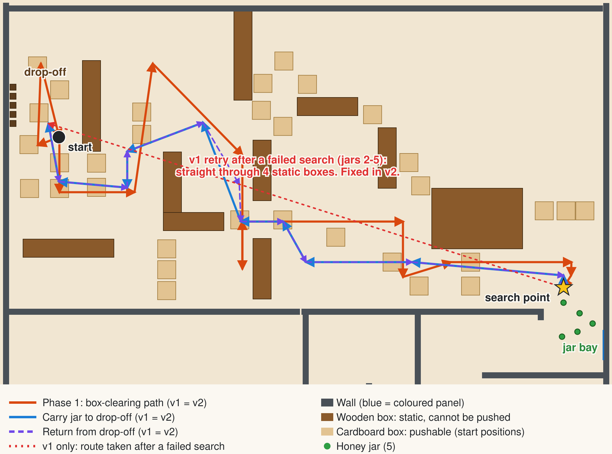

# 🤖 Autonomous Warehouse Robot: Webots Simulation

[](https://github.com/morganwhite13/Autonomous-Robot-Jar-Collection-System/actions/workflows/ci.yml)

An autonomous Pioneer 3-DX robot in **Webots** that clears a path through a 20 × 20 m warehouse, finds five honey jars with its camera, picks each one up with its gripper and delivers it to its own drop-off pad, with no human input.

**Tech stack:** Webots R2025a, Java, computer vision, robotics.

This repository holds **two versions side by side**:

| | |
|---|---|
| **v1: original** | The controller from the demo videos, kept **byte-for-byte unchanged** in [`controllers/ProjectController3`](controllers/ProjectController3/ProjectController3.java) |
| **v2: improved** | Same routes, thresholds and gripper timings, restructured into testable classes with 9 bugs and 4 smaller issues fixed, in [`controllers/JarCollectorV2`](controllers/JarCollectorV2/) |

👉 **[Full before/after write-up](docs/BEFORE_AND_AFTER.md)**: each fix with the original line numbers, plus [measured results](docs/benchmark-results.md).

---

## 📺 Video demos (v1)

- **[Main robot demo](https://www.youtube.com/watch?v=kO9e8dzjCfg)**: a full autonomous mission collecting the jars
- **[Top-down overview](https://www.youtube.com/watch?v=dIo8oXvvNeM)**: aerial view of navigation and collection
- **[Robot camera feed](https://www.youtube.com/watch?v=sPnMvLkUqaw)**: what the robot sees while it searches and approaches

---

## ⚖️ Before and after at a glance

| | v1 (before) | v2 (after) |
|---|---|---|
| After a failed search for jars 2-5 | Drives a 17.8 m straight line through 4 immovable wooden boxes | Returns 0.8 m to the search point |
| Robot blocked while driving | Pushes forever | Detects the stall in ~4 s and moves on |
| "360°" jar scan | Covers ~271° (fixed 200 steps) | Covers 370°, measured by the compass |
| Turn finishes (6,240 start/target pairs, kinematic model) | 91.8%. Can bounce across the ±3° window forever | 100% |
| End of a 530 cm leg started 2.9° off | 26.8 cm from the waypoint | 1.1 cm |
| Longest approach before the time limit aborts it | ~58 cm (jars start 50-162 cm away) | Aborts only when not moving; ~176 cm cap |
| No jar can be found | Retries forever | Stops after 3 attempts with a report |
| Tests / CI | none | 46 JUnit tests, GitHub Actions on JDK 11 and 21 |
| Telemetry | Progress messages | Simulated-time log plus an end-of-run mission report |
| Repo opens in Webots | No: flat layout, missing protos, stale `.class` built from older code | Standard Webots project layout; missing protos documented |

The numbers come from running ports of v1's methods and the real v2 classes on the same kinematic model of the robot. **Neither version has been re-run in Webots since the rewrite**; see [how it was checked](docs/BEFORE_AND_AFTER.md#how-this-was-checked-and-what-still-needs-checking).

---

## 🗺️ The mission



*Generated from the world file and the controller's waypoints by [`tools/MapRenderer.java`](tools/MapRenderer.java). The unused southern half of the arena is cropped.*

1. **Clear the path**: follow a 15-waypoint route from the start, pushing cardboard boxes aside, and end at the search point outside the jar bay.
2. **Search**: rotate a full turn, scoring each camera frame by how many jar-green pixels it contains, with a bonus when they're in the centre third. Turn to the best heading.
3. **Approach and grab**: creep forward, steering towards whichever third of the image is clearly greenest, until the front bumper is pressed. Then close the gripper and lift.
4. **Deliver**: follow a 10-waypoint route to the drop-off lane, line up with that jar's pad (one per jar, 30 cm apart), release, back out.
5. **Repeat** from the drop-off for the remaining jars.

---

## 🏗️ How it works

### Simulated hardware

| Part | Used for |
|---|---|
| **Pioneer 3-DX** differential drive | Wheel speed up to 5 rad/s (≈0.49 m/s) |
| **Camera**, 64 × 64 RGB, 45° field of view | Finding and steering towards jars |
| **Compass** | Heading for every turn and for measuring the scan |
| **Touch sensor** (front bumper) | Knowing when a jar is between the gripper fingers |
| **Pioneer gripper** (lift motor and two finger motors) | Grabbing, lifting and releasing jars |
| **Supervisor API** | Ground-truth position for waypoint navigation |
| 6 sonar sensors | Printed once in the start-up self-test; not used for navigation (yet) |

### Jar detection

A pixel counts as jar green when `R < 120`, `G > 35` and `B < 120` (v1's thresholds). v2 also requires green to beat red and blue by 10 so grey and brown pixels don't count. The frame is split into left / centre / right thirds (21 / 22 / 21 columns):

- **Scan score** = green pixels, **+50** if the centre third has the most.
- **Approach steering**: if one third leads both others by more than 10 pixels, turn towards it (inner wheel ×0.3, outer ×1.2). If the centre leads, or there are more than 30 green pixels, go straight. Otherwise stop for 5 steps and look again.
- **Give up** after 31 frames in a row with fewer than 15 green pixels.

### Navigation (v2)

Each leg turns in place towards the waypoint, then drives to it:
- **Turn:** full speed until within 30° of the target, then proportional slow-down, stopping within ±3°. The error is computed safely across 0°/360°.
- **Drive:** full speed with a small proportional correction towards the waypoint, stopping once the robot has travelled the leg's length (v1's rule). If it moves less than 2 cm in 40 steps it reports a stall and continues with the next leg.

### v2 code structure

| Class | Responsibility |
|---|---|
| [`JarCollectorV2`](controllers/JarCollectorV2/JarCollectorV2.java) | Webots entry point |
| [`Mission`](controllers/JarCollectorV2/Mission.java) | The phase sequence, knows where the robot is, retry limit |
| [`Navigator`](controllers/JarCollectorV2/Navigator.java) | Turning, driving, stall detection |
| [`JarHandler`](controllers/JarCollectorV2/JarHandler.java) | Scan, approach, grab, place |
| [`Vision`](controllers/JarCollectorV2/Vision.java) | Pixel classification, sector counts, steering decision (pure functions) |
| [`Routes`](controllers/JarCollectorV2/Routes.java) | All waypoints, defined once |
| [`Config`](controllers/JarCollectorV2/Config.java) | Every tunable number, each marked "v1" or "new" |
| [`RobotPlatform`](controllers/JarCollectorV2/RobotPlatform.java) / [`WebotsPlatform`](controllers/JarCollectorV2/WebotsPlatform.java) | The robot interface, and its Webots implementation (the only class that uses the Webots API) |
| [`MissionStats`](controllers/JarCollectorV2/MissionStats.java), [`Log`](controllers/JarCollectorV2/Log.java) | Telemetry and simulated-time logging |
| [`Angles`](controllers/JarCollectorV2/Angles.java), [`Vec2`](controllers/JarCollectorV2/Vec2.java), [`RgbImage`](controllers/JarCollectorV2/RgbImage.java) | Small value types and heading arithmetic |

Because the mission logic only talks to `RobotPlatform`, the tests can run it against [`KinematicRobot`](tests/KinematicRobot.java), a differential-drive model with a synthetic camera, without Webots.

At the end of every run v2 prints a report like this one (this example is from the kinematic model, so the times will differ in Webots):

```
==================== MISSION REPORT (v2) ====================
Result: 5/5 jars delivered in 815.2 s of simulated time

Time by phase (summed over all jars)
  Start-up                      1.3 s
  Clearing path                89.4 s
  Travel to search point      234.8 s
  Search and grab             168.7 s
  Carry to drop-off           284.4 s
  Place jar                    36.4 s

Jar   Time (s)  Scans  Approaches  Result
  1       86.8      1           1  delivered
  ...
Anomalies: drive stalls=0, drive timeouts=0, turn timeouts=0, failed searches=0
```

---

## 🚀 Running it

### Prerequisites
- **[Webots R2025a](https://cyberbotics.com/)**
- **JDK 11 or newer** on your `PATH` (Webots compiles Java controllers itself)
- **The robot protos.** The world loads `protos/Pioneer3dx.proto` and `protos/Pioneer3Gripper.proto`, which aren't in the repository. See [`protos/README.md`](protos/README.md): copy in your originals, or try `tools/fetch-protos.sh` (untested).

### In Webots
1. `git clone https://github.com/morganwhite13/Autonomous-Robot-Jar-Collection-System.git`
2. Add the protos (above).
3. **File → Open World** and choose:
   - `worlds/ProjectWorld2025.wbt` for **v1**, or
   - `worlds/ProjectWorld2025_v2.wbt` for **v2** (same world, different controller).
4. Press ▶. The console shows progress; v2 prefixes every line with the simulated time and ends with the mission report.

### Tests (no Webots needed)
```bash
tools/run-tests.sh
```
This compiles both controllers, runs the 46 JUnit tests, and regenerates [`docs/benchmark-results.md`](docs/benchmark-results.md) and the map above. JUnit is downloaded on first run. To compile against your real Webots install instead of the bundled API stubs, set `WEBOTS_HOME`:

```bash
WEBOTS_HOME=/usr/local/webots tools/run-tests.sh
```

---

## 📁 Repository layout

```
worlds/
  ProjectWorld2025.wbt         v1 world (unchanged)
  ProjectWorld2025_v2.wbt      same world, runs the v2 controller
controllers/
  ProjectController3/          v1 controller (unchanged)
  JarCollectorV2/              v2 controller
protos/                        robot protos go here (see README inside)
tests/                         JUnit tests, kinematic robot model, ports of v1 methods
tools/
  run-tests.sh                 build + test + regenerate docs
  BeforeAfterBenchmark.java    v1 vs v2 measurements
  MapRenderer.java             draws docs/images/mission-map.svg
  WorldFile.java               reads obstacle footprints from the .wbt file
  fetch-protos.sh              rebuilds the robot protos from Webots R2021b (untested)
  webots-stubs/                compile-only Webots API stubs for CI
docs/
  BEFORE_AND_AFTER.md          the full comparison
  benchmark-results.md         generated measurements
  v1-original-README.md        the original README, unchanged
```

---

## 🎓 What I learned

### Robotics fundamentals
- Sensor integration and fusion techniques
- Motor control and feedback loop design
- Path planning in constrained environments
- Real-time control system architecture

### Computer vision
- Colour-space analysis (RGB thresholding)
- Spatial segmentation techniques
- Real-time image processing (a 64×64 frame every control step)

### Real-time systems
- Timing-critical operations and control loops
- Sensor synchronisation and coordination
- Hardware abstraction layers
- Performance optimisation under constraints

### Problem solving and debugging
- Debugging with limited feedback (simulation logs)
- Handling sensor noise and ambiguity
- Iterative algorithm refinement through testing
- Root cause analysis for mission failures

### Software engineering
- Organising a large single-file controller, and later splitting it into focused classes (v2)
- API design and hardware abstraction
- State machine implementation
- Code modularity and maintainability
- Testing control logic without the simulator, using a kinematic model (v2)
- Characterisation tests that pin down old behaviour before changing it (v2)

### Practical skills
- Webots simulation environment mastery
- Java real-time programming
- Git version control and repository management
- Technical documentation and reporting

---

## 🔮 Future improvements

### Next, following on from v2
1. Run both versions in Webots and put v2's mission report next to v1's run time
2. Commit the robot protos so the repository runs as cloned
3. Use the front sonars to detect obstacles, instead of only noticing a stall afterwards
4. A real grab check, calibrated from the "camera now sees N green px" line v2 logs after each lift

### Original roadmap
5. **Dynamic pathfinding**: replace hardcoded waypoints with A* or Dijkstra (`tools/WorldFile.java` already extracts the obstacle footprints)
6. **Obstacle mapping**: build a real-time obstacle map from the distance sensors
7. **Machine learning**: train a CNN for robust detection in variable lighting
8. **Configuration file**: externalise parameters. *Partly done: v2 gathers them all in `Config.java`*
9. **SLAM**: simultaneous localisation and mapping for unknown environments
10. **Multi-robot coordination**: swarm behaviour for collaborative collection
11. **Reinforcement learning**: let an agent optimise its behaviour through trial and error
12. **Web dashboard**: real-time monitoring of the robot's state
13. **Real hardware**: port to an actual Pioneer 3-DX or mobile manipulator
14. **Force-feedback gripper**: pressure sensing for delicate objects
15. **Behaviour trees**: more sophisticated state management
16. **ROS 2 integration**: compatibility with the wider robotics ecosystem

---

## 🏆 Acknowledgments

- **Webots simulation platform**: professional robotics simulator
- **Cyberbotics**: comprehensive documentation and community support
- **Java community**: robust cross-platform development tools
- **Pioneer 3-DX community**: reference implementations and best practices

---

## 📞 Contact

- [**Portfolio**](https://morganwhite13.github.io/)
- [**Email**](mailto:morgan13white@icloud.com)
- [**LinkedIn**](https://www.linkedin.com/in/morgan-white-95b245237/)
