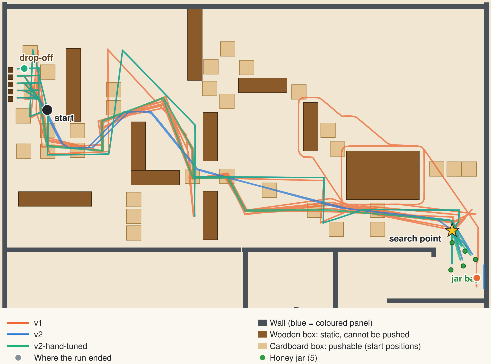
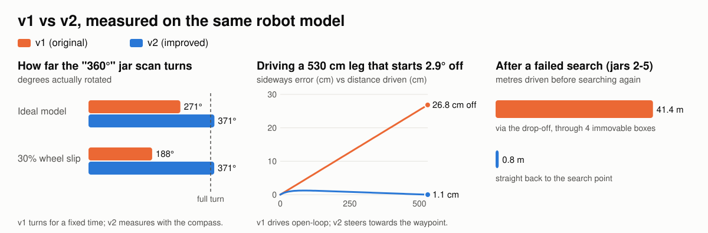
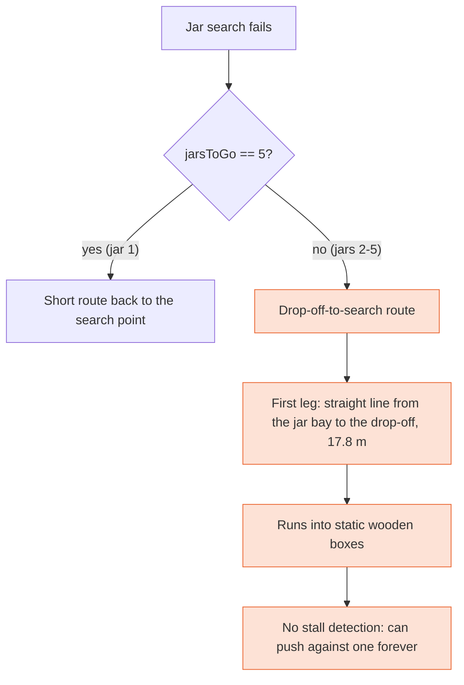

# Before and after

This repository holds two versions of the same robot controller, side by side:

| | v1 (before) | v2 (after) |
|---|---|---|
| Controller | [`controllers/ProjectController3/`](../controllers/ProjectController3/ProjectController3.java) | [`controllers/JarCollectorV2/`](../controllers/JarCollectorV2/) |
| World | [`worlds/ProjectWorld2025.wbt`](../worlds/ProjectWorld2025.wbt) | [`worlds/ProjectWorld2025_v2.wbt`](../worlds/ProjectWorld2025_v2.wbt) |
| Status | Original code, **byte-for-byte unchanged** (only moved into a Webots project layout) | Same algorithm, restructured, with the bugs below fixed |

The two world files are identical except for one line: `controller "ProjectController3"` versus `controller "JarCollectorV2"`. v2 keeps every waypoint, gripper position and timing, approach speed, steering rule and vision threshold from v1 (`RoutesTest` and `VisionTest` check this against the original values). The changes are in *how* the robot moves between those points and what it does when something goes wrong.

Line numbers below refer to [`controllers/ProjectController3/ProjectController3.java`](../controllers/ProjectController3/ProjectController3.java).

---

## How this was checked, and what still needs checking

**In Webots (real physics):**
- Both versions ran the whole mission in Webots R2025a, headless, through `tools/run-in-webots.sh`. An observer supervisor judges both by the same rule: a jar counts once it rests in the drop-off lane. Results are below and in [`webots-results.md`](webots-results.md).
- The runs are repeatable: rerunning v2 reproduced its log and path step for step.
- Getting there took two fixes outside the controllers, both to the reconstructed robot protos (below). It also took one change to v2, slower turns while carrying a jar, which only real physics could show was needed.

**On a kinematic model (fast, and run in CI):**
- Both controllers compile against the real Webots R2025a `Controller.jar`. CI compiles them against API stubs whose signatures were copied from that jar.
- 141 JUnit tests, covering 99% of the lines in v2's logic (measured with `tools/run-tests.sh --coverage`). Most run v2's real navigation, search and mission classes on a kinematic model of the Pioneer 3-DX (wheel radius 9.75 cm, axle track 33 cm, 32 ms steps, synthetic 64x64 camera). A small scripted fake covers the edge cases the model can't stage, such as exact pixel counts or the bumper pressing mid-pause.
- Mutation testing (`tools/mutation-test.sh`, [PIT](https://pitest.org/)): of 403 small deliberate bugs injected into v2's logic, the tests catch 379 (94%). The first run caught only 56%, even with 96% line coverage, which is what prompted most of the tests above. The 24 that survive were each checked by hand. 7 can't change behaviour, such as `d < 0` vs `d <= 0` before a wrap-around that maps 360 back to 0. 9 only change log text. 8 only differ when a measured distance or angle lands exactly on a threshold, like 2.000… cm of progress. CI fails below 90%.
- Refactors are checked against a recorded baseline: full mission logs from 6 scenarios (ideal model, planned routes, motor lag and wheel slip, one jar, no jars, blocked start) plus every way an approach can end. The logs, timings, positions and wheel commands must match the previous version exactly.
- The v1 methods being compared, and v1's whole mission loop, were ported line for line into [`tests/LegacyV1.java`](../tests/LegacyV1.java) and [`tests/LegacyV1Mission.java`](../tests/LegacyV1Mission.java) and measured on the same model ([`docs/benchmark-results.md`](benchmark-results.md)). [`LegacyBehaviourTest`](../tests/LegacyBehaviourTest.java) pins each v1 behaviour described here, so the claims fail loudly if they stop being true.
- Route geometry was checked against the obstacles parsed from the `.wbt` file.

**Still not checked:** the robot protos are reconstructions (Cyberbotics' Webots R2021b Pioneer 3-DX), because the originals were never committed. The original robot may have differed. For example, the [demo videos](../README.md) show jars being collected, and on this reconstruction v1 never delivers one. Each Webots result is a single run, because the simulation is deterministic: the same inputs give the same run. Every behaviour change can be switched back to v1's behaviour in [`Config.java`](../controllers/JarCollectorV2/Config.java) (see the last section).

---

## Measured in Webots

Both versions run the whole mission in Webots R2025a, with real physics, the same world (apart from the controller name), the same reconstructed robot, and the same observer judging deliveries. Generated by `tools/run-in-webots.sh --limit 2400 v1 v2 v2-planned` into [`webots-results.md`](webots-results.md). `v2-planned` is v2 with its opt-in A*-planned routes.

| | v1 | v2 | v2-planned |
|---|---|---|---|
| Jars delivered | 0/5 | 5/5 | 5/5 |
| Jars the controller says it delivered | 3 | 5 | 5 |
| Mission time (last jar delivered) | did not finish (stopped at 2400 s (40.0 min)) | 879 s (14.7 min) | 788 s (13.1 min) |
| Jar delivery times (s) | - | 189, 353, 527, 733, 879 | 177, 321, 474, 655, 788 |
| Stuck in one place from | 745 s to the end | - | - |
| Distance driven | 199 m | 276 m | 247 m |
| Jars knocked out of the drop-off lane afterwards | 0 | 0 | 0 |
| Approach aborted | 6 | 0 | 0 |
| Full scan saw no jar | 0 | 0 | 0 |
| Whole search failed | 1 | 0 | 0 |
| Drive stalled or timed out (v2 detects these; v1 cannot) | 0 | 0 | 0 |



**What v1 did.** Every failure below was predicted from the code:
- **It aimed at the wrong things.** Its green test also counts the floor and grey walls ([bug 9](#9-dark-grey-and-brown-pixels-counted-as-jar-green)). Every scan saw 2,600-3,300 "green" pixels at 36-64°, pointing away from the jars, and it turned there.
- **It grabbed nothing, three times, and counted each one.** Driving that way, the bumper eventually touched a wall or box. v1 closed the gripper on nothing, carried nothing to the drop-off, "placed" it and printed "Jars remaining: 4", then 3, then 2. It never checks its grip ([smaller fixes](#10-smaller-fixes)).
- **Then it got stuck for good.** On jar 4 all three searches failed. v1 then took the route meant to start from the drop-off, but from the search point ([bug 1](#1-a-failed-search-sent-the-robot-straight-across-the-arena-serious)). It ended up against the corner of the big wooden box beside the jar bay, and from 745 s it never moved again. With no stall detection ([bug 3](#3-drives-had-no-timeout-or-stall-detection)) it was still trying when the run was stopped at 2400 s.
- **Its runs differ.** v1 picks its random turns with unseeded `Math.random()`. An earlier run went the same way up to jar 4, then got stuck elsewhere, at 659 s. v2's runs are identical every time.

**What v2 did.** It cleared the boxes in 90 s with no stalls, found each jar with one scan, grabbed it on the first approach and delivered all five in 879 s. It reported no stalls, timeouts or failed searches. Every grab logged a grip effort of 1.00, the finger motors pushing at their limit. With the opt-in A*-planned routes, it delivered all five in 788 s, 10% sooner, driving 247 m instead of 276 m.

**What it took.** v2 didn't work in Webots on the first try. Getting it there found these problems, in this order:

| Problem | Symptom | Fix |
|---|---|---|
| The protos had their header changed from R2021b to R2025a | Webots skipped its conversion of pre-2022 files. The wheels' collision cylinders lay across the wheels, so the robot dropped onto its caster every half turn and stalled for about 2.5 s with the wheels spinning. The camera looked out of the right side, rolled 90°, so jars were seen while they were beside the robot. Both versions failed for reasons that had nothing to do with their code. | Original header restored; a test pins it ([`protos/README.md`](../protos/README.md)) |
| Full-speed turns while carrying a jar | The jar flew out within 0.6 s of the first turn towards the drop-off and landed on its side next to the search point, where it couldn't be grabbed again. v1 has the same problem: it turns at full speed too. | v2 turns at a third of full speed while carrying ([bug 11](#11-full-speed-turns-threw-the-jar-out-of-the-gripper-found-in-webots)) |
| Wheels kept turning after v2 finished | Webots applies motor commands on the next step, so a mission that ended right after backing up left the robot reversing. | v2 stops and steps once before exiting |

Two things to keep in mind:
- **The robot is a reconstruction.** The original protos were never committed; these are Cyberbotics' R2021b Pioneer 3-DX. The demo videos show jars being collected, so the original setup may have suited v1 better, or the videos may show the older v0.
- **v2's opt-in additions were all off** (grab check, sonar watch, planned routes) in the `v2` run. The `v2-planned` column has only the planned routes on.

---

## Measured on the kinematic model

<picture>
  <source media="(prefers-color-scheme: dark)" srcset="images/before-after-dark.svg">
  
</picture>

| Check | v1 (before) | v2 (after) |
|---|---|---|
| Turn-in-place finishes (6,240 start/target pairs) | 91.7% | **100%** |
| Turn-in-place mean steps when it finishes | 16.7 | 22.9 (slower near the target, on purpose) |
| Rotation actually covered by the "360°" jar scan | **271°** | 371° |
| Scan finds a jar 1 m away, 45° right of the starting heading | no (blind spot) | yes |
| 530 cm leg started 2.9° off (inside the ±3° turn tolerance): distance from the waypoint at the end | **26.8 cm** | 1.1 cm |
| Drive blocked by an immovable obstacle | never returns | stall detected after 3.8 s |
| Longest approach before the time limit aborts it | 59 cm | 176 cm, and aborts early only if not moving |
| Route after a failed search for jars 2-5 | 41 m, first leg through **4 static wooden boxes** | 0.8 m |
| Mission when no jar can be found | retries forever | stops after 3 failed searches with a report |
| A jar slips out of the gripper on the first grab | reports success, holding nothing | with the grab check on (off by default): holding the jar after 2 grabs |
| 30 cm box in the middle of a straight 3 m leg | hits it at 49 cm/s and keeps pushing | hits it at 49 cm/s and gives up after 3.8 s; with the sonar watch on (off by default) never touches it, stopping 24 cm short |
| Whole mission (walls and wooden boxes solid) | **0/5 jars, never finishes**: stuck from 20 s turning on the 5th leg of the box-clearing route | 5/5 jars, 876 s simulated, 0 stalls |

**With motor lag and wheel slip.** The model is ideal, so the benchmark repeats the checks with every wheel command applied 64 ms late and turns reaching only 70% of their ideal rate. Neither version was tuned for these values.

| Check | v1 (before) | v2 (after) |
|---|---|---|
| Turn-in-place finishes | 100% | 100% |
| Rotation actually covered by the "360°" jar scan | **188°** | 371° |
| 530 cm leg started 2.9° off: distance from the waypoint at the end | 26.8 cm | 0.6 cm |
| Whole mission (walls and wooden boxes solid) | **0/5 jars, never finishes**: from 47 s, pushes against a wooden box on the box-clearing route | 5/5 jars, 957 s simulated, 0 stalls |
| Whole mission on 20 robot variants (motor lag 0-3 steps x turn rate 60-100%) | **finishes 0 of 20**; at most 2 jars delivered | finishes 20 of 20, in 873-1005 s |

**The whole-mission rows** run a line-for-line port of v1's `main` loop and everything it calls ([`tests/LegacyV1Mission.java`](../tests/LegacyV1Mission.java)) against the real v2 classes, from the world's start pose. Walls and wooden boxes are solid, and the cardboard boxes are left out because the model can't push them. v1 fails in two different ways:
- **On the ideal model it never gets past the box-clearing route** ([bug 4](#4-turns-could-bounce-around-the-target-heading)). v1 turns at full speed, about 5.4° per step, but stops only when its whole-degree compass reading is strictly within 3 of the target. That window is about 5° wide, narrower than one step, so a turn can step back and forth over it forever. On the 5th leg, which heads for 0°, the window is only 4°, because the check doesn't wrap around 0/360, and that's where it happens.
- **With lag and slip its turns finish, but each one overshoots,** because the motors keep turning for the lag after v1 stops them. v1 drives every leg without steering ([bug 5](#5-straight-legs-drifted-off-line)), so the error adds up from leg to leg. At 47 s, on the 8th leg of the box-clearing route, it drives into a wooden box. It has no stall detection ([bug 3](#3-drives-had-no-timeout-or-stall-detection)), so it pushes until the run is stopped.
- **Where v1 gets stuck depends on the details, but it always does.** Across 20 variants of the robot (motor lag 0-3 steps, turn rate 60-100% of ideal) v1 never finishes, and delivers at most 2 jars. v2 finishes all 20. An independent check also varied the robot's collision radius (15 and 19 cm) and got the same picture. The model uses 19 cm, half the Pioneer's 38 cm width.

The model is kinder to v1 than Webots was, in two ways. Its camera only draws jars, while in Webots v1's loose green test also counted the floor and walls and aimed it away from every jar ([bug 9](#9-dark-grey-and-brown-pixels-counted-as-jar-green)). And on the model a blocked robot stays put. In Webots, contact pushed v1 far enough to finish the box-clearing route, and it got stuck later instead (see [Measured in Webots](#measured-in-webots)).



`LegacyBehaviourTest` pins both results. The model's mission times grew when v2 started turning more gently while carrying a jar ([bug 11](#11-full-speed-turns-threw-the-jar-out-of-the-gripper-found-in-webots)). The model can't throw a jar unless told to, but Webots showed that full-speed turns do.

The full generated tables are in [`benchmark-results.md`](benchmark-results.md). Regenerate them with `tools/run-tests.sh`.

---

## Bugs fixed

### 1. A failed search sent the robot straight across the arena (serious)
**v1:** `main` picks the route to the search point with `if (jarsToGo == 5)` (line 130). Only jar 1 uses the short route. For jars 2-5 it uses `navigateFromDropoffToSearch()`, which assumes the robot is at the drop-off. After a failed search (lines 144-148) the robot is still at the search point, so the route's first leg (line 588) is a straight 17.8 m line from the jar bay to the drop-off. That line passes through four wooden boxes, which have no mass in the world file and so cannot be pushed. Combined with bug 3 below, the robot could push against one forever.



**v2:** [`Mission`](../controllers/JarCollectorV2/Mission.java) tracks whether the robot is at the drop-off and takes the 0.8 m hop back to the search point after a failed search. It also drops v1's extra random move after a failed search (line 147): the robot drives straight back to the same search point anyway, so it only risked knocking a jar. Random moves inside a search (when a full scan sees nothing) are kept. The red dotted line on the [mission map](images/mission-map.svg) shows the old route.

<details>
<summary>Code: v1 vs v2</summary>

v1 (`ProjectController3.java`, lines 129-148):
```java
// Go to search area
if (jarsToGo == 5) {
  navigateToSearchArea();
} else {
  navigateFromDropoffToSearch();   // assumes the robot is at the drop-off
}
boolean success = intelligentJarSearch(timeStep);
if (success) {
  ...
} else {
  System.out.println("CRITICAL: Failed to find jar after all attempts!");
  moveRandomly(timeStep);          // then loops back to the "if" above
}
```

v2 (`Mission.java`):
```java
List<Vec2> route = atDropoff ? Routes.DROPOFF_TO_SEARCH : Routes.TO_SEARCH_POINT;
nav.followRoute(route);
atDropoff = false;

if (!jars.searchAndGrab()) {
  stats.recordFailedSearch();
  if (++failedInARow >= Config.MAX_CONSECUTIVE_FAILED_SEARCHES) {
    break;                          // stop and print the mission report
  }
  continue;                         // still at the search point: short route next time
}
```
</details>

### 2. Endless retries
**v1:** `while (jarsToGo > 0)` (line 126) has no attempt limit, so a jar that cannot be found makes the program run forever.
**v2:** Stops after `MAX_CONSECUTIVE_FAILED_SEARCHES` (3) failures in a row and prints what it achieved.

### 3. Drives had no timeout or stall detection
**v1:** `moveHardcodedAhead` (lines 709-715) loops until the robot is far enough from where it started. If the robot is blocked, that never happens.
**v2:** [`Navigator.driveTo`](../controllers/JarCollectorV2/Navigator.java) checks progress every 40 steps. If the robot moved less than 2 cm, it reports a stall and continues with the next waypoint. Each drive also has a hard timeout. Both are counted in the mission report.

### 4. Turns could bounce around the target heading
**v1:** `makeHardcodedTurn` (lines 722-765) always turns at full speed, about 5.4° per 32 ms step, and stops only when the integer heading lands strictly inside `finalAngle ± 3` (line 748). That window is 5 values wide, so a step can jump over it, reverse, and jump back. On the model, 8.3% of start/target pairs never finished. An independent check with a different heading-only model ([PR #1](https://github.com/morganwhite13/Autonomous-Robot-Jar-Collection-System/pull/1)) found about the same rate: 135 of 1,296 turns never settled. The check also doesn't wrap around 0/360: a target of 0° only accepts 0-2°, and 359° only accepts 357-359°. It also always turns for one step before checking, even when already aligned.

How often this bites depends on how fast the robot really turns. When slip slows the turn to 70% of the ideal rate, each step is small enough to land in the window and all of v1's turns finish. So in Webots it may show up as occasional extra swinging rather than a hang. The wrap-around gap remains either way.

**v2:** Uses a seam-safe heading error, full speed down to 30° from the target, then proportional slow-down. It checks before moving and has a timeout. It finished 100% of pairs, at about 0.2 s extra per turn.

<details>
<summary>Code: v1 vs v2</summary>

v1 (`ProjectController3.java`, lines 746-760), always at full speed:
```java
while (robot.step(timeStep) != -1) {
  int degrees = (getCompassReadingInDegrees(compass) + 360) % 360;
  if (degrees > finalAngle - 3 && degrees < finalAngle + 3)   // not wrap-safe
    break;
  int distTurningRight = (degrees - finalAngle + 360) % 360;
  int distTurningLeft = (finalAngle - degrees + 360) % 360;
  if (distTurningRight < distTurningLeft) {
    leftMotor.setVelocity(MAX_SPEED);  rightMotor.setVelocity(-MAX_SPEED);
  } else {
    leftMotor.setVelocity(-MAX_SPEED); rightMotor.setVelocity(MAX_SPEED);
  }
}
```

v2 (`Navigator.java`), check first, slow down near the target, give up eventually:
```java
for (int i = 0; i < Config.TURN_TIMEOUT_STEPS; i++) {
  double error = Angles.delta(robot.headingDeg(), targetDeg);      // in (-180, 180]
  if (Math.abs(error) <= Config.HEADING_TOLERANCE_DEG) {
    robot.stop();
    return true;
  }
  double speed = clamp(maxSpeed * Math.abs(error) / Config.TURN_SLOWDOWN_DEG, minSpeed, maxSpeed);
  if (error > 0) robot.drive(-speed, speed); else robot.drive(speed, -speed);
  robot.step();
}
```
</details>

### 5. Straight legs drifted off line
**v1:** Drives open-loop. A turn that ends 2.9° off (allowed by the ±3° tolerance) puts the robot 26.8 cm from the waypoint at the end of the 530 cm leg. Box pushing adds more error.
**v2:** Steers towards the waypoint while driving: a proportional correction capped at 20% of wheel speed, switched off in the last 20 cm. It ends 1.1 cm away.

### 6. The "360°" scan covered about 270°
**v1:** `rotateAndFindGreen` rotates for a fixed 200 steps at `MAX_SPEED / 4` (lines 206-212). With the Pioneer's wheel geometry and the default 32 ms step that is about 271°. Since the robot always turns left, a jar slightly right of the starting heading is never in view.
**v2:** Adds up the compass heading changes and stops after 370°. This also makes it independent of how fast the robot actually turns: with 30% wheel slip, v1's fixed 200 steps cover only 188°, while v2 still covers a full turn.

### 7. Approaches were cut off after about 58 cm
**v1:** The approach loop has two limits: `maxApproachSteps = 400` (line 277) and `approachSteps > 300` (line 370). The 300 check always triggers first, so 400 is dead code. 300 steps at `MAX_SPEED / 8` is about 58 cm of travel. The jars start 50-162 cm from the search point and the bumper touches at about 25 cm, so for 4 of the 5 starting jar positions the first approach would stop with "Approach taking too long, probably hitting wall!". The robot then backs up and scans again.
**v2:** Checks the thing that message was guessing at. It aborts if the robot moved less than 2 cm in 60 steps (pushing against something), with a hard cap of 900 steps (~176 cm).

### 8. Ending the simulation was ignored
**v1:** Most loops ignore the `-1` that `robot.step()` returns when Webots stops the simulation (for example `delay()` at line 46 and the fixed-count loops at lines 212, 399-426, 444, 456 and 646). The main loop could then keep cycling.
**v2:** All stepping goes through `RobotPlatform.step()`, which throws `SimulationEnded`. Every loop unwinds and the controller exits cleanly.

### 9. Dark grey and brown pixels counted as jar green
**v1:** A pixel is "green" if `R < 120 && G > 35 && B < 120` (line 543). That includes grey (50, 50, 50) and brown (100, 80, 60), so shadows and dark surfaces add to the count.
**v2:** Keeps those thresholds and also requires green to beat red and blue by 10. `VisionTest` checks that v2 accepts only pixels v1 also accepted, and still accepts shaded and washed-out jar colours. v1's pixel-count thresholds (20, 15, 30) were tuned on v1's counts, so during approaches v2 logs both counts ("v1 rule: N px"). In Webots the stricter test found every jar with one scan and counted nothing elsewhere. v1's test counted up to 3,300 "green" pixels where there was no jar, mostly floor and walls, and its scans pointed it away from the jars.

### 10. Smaller fixes
- **Bumper ignored while pausing:** during the 5-step "reassess" pause (lines 357-367) v1 did not read the touch sensor. v2 does.
- **Grab "verification":** v1 printed "Verifying grab..." (line 422) but only waited 20 steps, so a jar that slipped out of the fingers was carried "home" anyway and counted as delivered. v2 has a real check, **off by default** (`Config.VERIFY_GRABS`):
  - **How it works:** after lifting, it reads the finger motors' force feedback. Fingers that closed on a jar stop against it and push at their limit, while fingers that closed on nothing stop pushing.
  - **What it does:** if the fingers are using less than half their maximum force, v2 lets go, backs up and tries again.
  - **Logging:** every grab logs this "grip effort", whether or not the check is on. In Webots all five grabs logged 1.00, and when a jar was thrown out of the gripper the finger force dropped to 0 at once, so the 0.5 threshold sits well between the two. It stays off because no real grab has missed yet, so it has never had to act.
  - **On the model:** with a jar that slips out on the first grab, v1 reports success while holding nothing, and v2 with the check on is holding the jar after its second grab. Over a whole mission with one slipped jar, v2 with the check off believes it delivered 5 jars while only 4 reach the pads; with the check on, all 5 do (`MissionTest`).
- **Unrepeatable runs:** `Math.random()` (line 437) made every run different. v2 uses a seeded `Random`, and `MissionTest` checks that two runs produce identical logs.
- **Compass precision:** v1 cast headings to `int` (line 522), losing up to 1°. v2 keeps doubles. `AnglesTest` checks that the formula is otherwise identical.
- **Sonars never used:** v1 enabled six sonars and only printed them at start-up (lines 110-119). v2 has an optional **sonar watch**, off by default until it's tuned in Webots (`Config.SONAR_WATCH`):
  - **What it does:** on travel legs, if the two front sonars (so3, so4) hear an echo closer than the waypoint, v2 slows down in proportion and stops 25 cm short instead of driving into it.
  - **Where it's off:** the box-clearing route, which has to push boxes, and placement, which drives up to the pads.
  - **The model's sonar:** it uses the proto's geometry and Webots' rule that a sonar gets no echo from a surface hit more than 22.5° off its normal.
  - **What changes:** on a clear course the watch changes nothing, and the runs are step-for-step identical (`MissionTest`). With a box in the way it never touches the box. After stopping it skips to the next waypoint, as it does after a stall; it doesn't plan a way around yet.

### 11. Full-speed turns threw the jar out of the gripper (found in Webots)
**v1:** After a grab, the first move towards the drop-off is a turn in place at full speed (`makeHardcodedTurn`, line 722), and so is every turn along the way.
**Found in Webots:** a supervisor logged the jar's position while the robot grabbed it and turned. The grab itself is solid: the fingers squeeze at their 10 N limit and the jar lifts 5 cm, upright. But turning at 5 rad/s throws it out within 0.6 s, and it lands on its side. At 2.5 rad/s it stays in the fingers through the turn, a full-speed straight drive and four hard stops; 1.67 rad/s holds it through the turn and drive too. v2's first Webots runs lost every jar this way: it grabbed them, then drove to the drop-off empty-handed.
**v2:** Routes driven with a jar in the gripper (to the drop-off, and lining up with the pad) turn at most at `Config.CARRY_TURN_SPEED`, a third of full speed. That's the speed v1 itself used for its manoeuvres. It costs about 12 s per delivery. `LegacyBehaviourTest` shows v1's first carry turn throwing the jar on a model told to throw it above 2.5 rad/s, and `MissionTest` shows v2 delivering all five on that model.

---

## Repository fixes

| Problem | Before | After |
|---|---|---|
| Stale compiled controller | `ProjectController3.class` was committed. It was compiled from an older version of the source: it contains `findJar()`, `toStart()` and `hardcodedPath()`, which don't exist in the `.java`. Webots never compiles Java controllers by itself; it runs the `.class` it finds. So anyone who opened the repository ran that old code, not the source. | Deleted (still in git history) and `*.class` ignored. Build from source with `tools/build-controllers.sh` or Webots' Build button (the README now says so). |
| Not a Webots project | Flat files. Webots looks for `controllers/<name>/` next to `worlds/`, and the world loads `../protos/*.proto`. | Standard `worlds/` + `controllers/` + `protos/` layout. |
| Missing robot protos | The world needs `Pioneer3dx.proto` and `Pioneer3Gripper.proto`, which were never committed, so nobody else could open it. | Included in `protos/`, reconstructed from Webots R2021b and run in Webots R2025a. They must keep their R2021b header so Webots converts them; a test checks it. See [`protos/README.md`](../protos/README.md). |
| No tests or CI | none | 141 JUnit tests (99% line coverage of v2's logic, 94% mutation score) and GitHub Actions on JDK 11 and 21. CI also checks that the generated benchmark and figures are up to date. |

---

## Code structure

| | v1 | v2 |
|---|---|---|
| Layout | 1 file, 765 lines (574 of code), everything `static` | 14 focused files (13 classes and the `RobotPlatform` interface), 1,657 lines (1,164 of code; the rest is comments and blank lines) |
| Webots API use | Spread through every method | Only in [`WebotsPlatform`](../controllers/JarCollectorV2/WebotsPlatform.java). Everything else uses the [`RobotPlatform`](../controllers/JarCollectorV2/RobotPlatform.java) interface, so it can be tested without Webots |
| Tunable numbers | Literals scattered through methods | All in [`Config`](../controllers/JarCollectorV2/Config.java), each marked "v1" (unchanged) or "new" |
| Waypoints | Rebuilt inline in 5 methods | Defined once, named, in [`Routes`](../controllers/JarCollectorV2/Routes.java) |
| Duplicate code | Camera-to-array copy twice (lines 217-228, 300-311); position read 7 times | One `captureImage()`, one `positionCm()` |
| Dead code | `WORLD_WIDTH`/`WORLD_HEIGHT`, blue-pixel counting, `GreenDetection.greenLeft/Center/Right`, `moveHardcodedAhead`'s always-`false` return, the 400-step limit | Removed |
| Telemetry | Progress messages without times | Every log line has the simulated time, and each run ends with a mission report: time per phase, per-jar scans and approaches, stalls, timeouts |
| Tests | 0 | 141, covering 99% of v2's logic lines (87% including the two classes that only run inside Webots) |
| Mutation testing ([PIT](https://pitest.org/)) | n/a | 94% of injected bugs caught (379/403); at least 90% enforced in CI (`tools/mutation-test.sh`) |
| Static analysis ([SpotBugs](https://spotbugs.github.io/), maximum effort, every priority) | 10 findings, all low severity: 5 unread fields, 3 `Math.floor` calls on constants, an int made via `nextDouble`, a field-naming slip | 0, enforced in CI (`tools/static-analysis.sh`) |

---

## The original README vs the code

The original README is kept unchanged in [`v1-original-README.md`](v1-original-README.md). Checking it against the code turned up something unexpected: **the repository held two different controllers.**

- **v1** is the committed source, `ProjectController3.java`, with `intelligentJarSearch`, `carefullyApproachGreen` and `executeGrab`.
- **v0** is an earlier version that survived only as the stale `ProjectController3.class` (deleted here; still in git history at `d598324`). Decompiled, it has `findJar()`, `toStart()`, `hardcodedPath()` and `placeJar()`, green thresholds of R < 80, G > 50 and B < 80, and `EPSILON = 15`. Its `toStart()` slows to `MAX_SPEED = 1` for turns.

The original README mixes descriptions of both, so several claims that look wrong for v1 were accurate for v0. The demo videos could show either version; only the author knows which. The new README describes the code that's actually in the repository.

| Original README | v0 (stale `.class`) | v1 (committed source) |
|---|---|---|
| "Operate without GPS, pre-mapped routes, or external guidance systems" | No: both are Webots Supervisors that read the robot's exact position from the simulator and follow hand-tuned waypoint routes. Only jar detection uses the onboard camera and touch sensor. | Same as v0 |
| Distance sensors "prevent collisions throughout mission" | No: enabled, never read | No: printed in a start-up debug test (lines 110-119), never used |
| Accelerometer for "stability monitoring" | No: never enabled or read | No: never enabled or read |
| Blue detection "used for navigation guidance during return phase" | No: blue counts are computed in `findJar()` but never used | No: counted (line 544), never used |
| "Max speed: 5 m/s", "reduced speed (1 m/s) during precision turns" | Yes, apart from the units: 5 and 1 are wheel speeds in rad/s (about 0.49 and 0.1 m/s) | 5 rad/s; turns always run at full speed |
| "Three-tier fallback" detection; turn when green leads by "15+ pixels" | Yes: `EPSILON = 15`, then a relative comparison, then a raw count above 10 | Partly: one margin, `EPSILON = 10` |
| Approach "maximum 400 steps"; "rotate 360°" scan | Not applicable: v0 approaches differently | 300 steps effective (bug 7); the scan turns about 271° (bug 6) |
| "Centimetre-scale integer math eliminates floating-point errors… ~15% more stable" | No: `double` maths | No: positions and distances are `double`; only the waypoint `Point`s are integers |
| "Test Coverage: 100% of core mission paths" | No tests | No tests |
| Open `simulation/ProjectWorld2025.wbt` | That folder didn't exist | That folder didn't exist |

---

## Switching v2 back to v1 behaviour

Each change is a constant in [`Config.java`](../controllers/JarCollectorV2/Config.java), which makes it easy to A/B test a single change in Webots:

| To get v1's… | Set |
|---|---|
| open-loop driving | `HEADING_HOLD_GAIN = 0` |
| full-speed turns | `TURN_MIN_SPEED = MAX_SPEED` and `TURN_SLOWDOWN_DEG = 0.001` |
| 300-step approach limit | `APPROACH_TIMEOUT_STEPS = 300` |
| exact green test | `GREEN_DOMINANCE_MARGIN = Vision.V1_COMPATIBLE_MARGIN` |
| full-speed turns while carrying a jar (throws it out in Webots) | `CARRY_TURN_SPEED = MAX_SPEED` |

The fixes for bugs 1-3, 8 and 10 have no switch, because they only change what happens when something has already gone wrong.

Three v2 additions are **off by default**:
- **A\*-planned routes (`USE_PLANNED_ROUTES`):** tried in Webots, where they delivered all five jars 10% sooner. They stay opt-in because v2 otherwise keeps every one of v1's waypoints, which keeps the before/after comparison like for like.
- **Grab check (`VERIFY_GRABS`):** calibrated from the Webots run's grip efforts, but it has never had to act, because no real grab has missed.
- **Sonar watch (`SONAR_WATCH`):** not tried in Webots yet.
