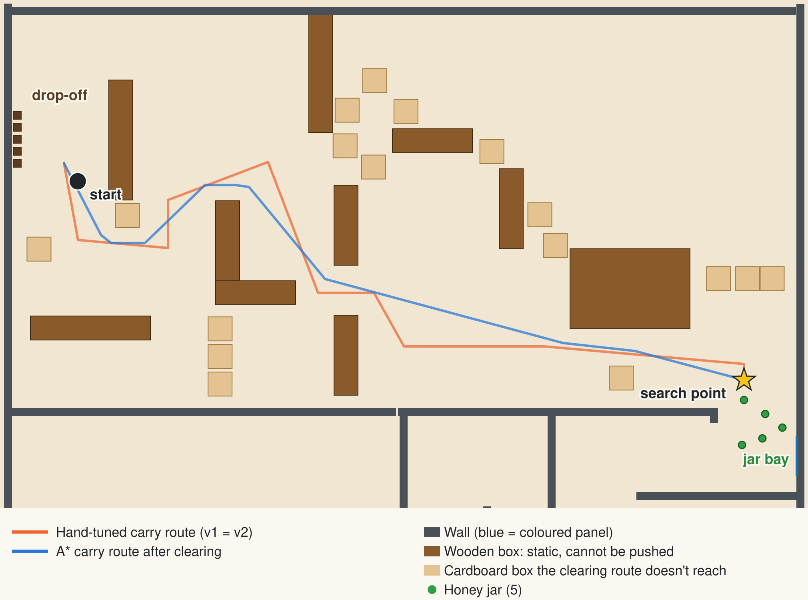

# Route planner: how good are the hand-tuned routes?

Generated by `tools/RoutePlannerReport.java` (run `tools/run-tests.sh`). **Analysis only:** neither controller uses the planner.

Both controllers drive hand-tuned waypoint routes. This compares them with the shortest routes an A* planner finds on a 5 cm grid built from the world file, keeping the same 35 cm clearance from every obstacle (see `tools/RoutePlanner.java`).

## Without the box-clearing phase there is no route

With all 32 cardboard boxes where they start, the planner finds **no route** between the search point and the drop-off. That's why the mission begins by pushing boxes aside along a 15-waypoint route.

## After clearing

Here the 15 cardboard boxes that the clearing route passes within 40 cm of are treated as pushed out of the way. The other 17 stay where they started, along with the walls and wooden boxes.

| Route | Hand-tuned (v1 = v2) | A* after clearing | A* with static obstacles only |
|---|---|---|---|
| Search point to drop-off (carry) | 23.4 m, 10 legs | 20.2 m, 10 legs (14% shorter) | 19.1 m, 6 legs (19% shorter) |
| Drop-off to search point (return) | 23.5 m, 11 legs | 20.2 m, 10 legs (14% shorter) | 19.3 m, 7 legs (18% shorter) |

The last column treats every cardboard box as gone, so it's a lower bound.

**What it means:** the hand-tuned routes are about 14% longer than the planned ones. Over a mission (5 carries, 4 returns) the planned routes would save about 30 m, or roughly 61 s of driving at full speed. Turns aren't counted, but both kinds of route have a similar number of legs. The saving also assumes the swept boxes really end up clear of the planned line. Webots confirmed it: on six shuffled worlds the median mission took 740 s on the planned routes and 837 s on the hand-tuned ones ([`webots-sweep.md`](webots-sweep.md)).

## In v2

v2 carries and returns on these routes by default (`Config.USE_PLANNED_ROUTES`, `Routes.PLANNED`). The stored carry route leaves the jar bay through (850, 100) like the hand-tuned one; the stored routes are 20.5 m (carry) and 20.2 m (return) long. To compare them with v1's waypoints in Webots, run `tools/run-in-webots.sh v2 v2-hand-tuned`.

