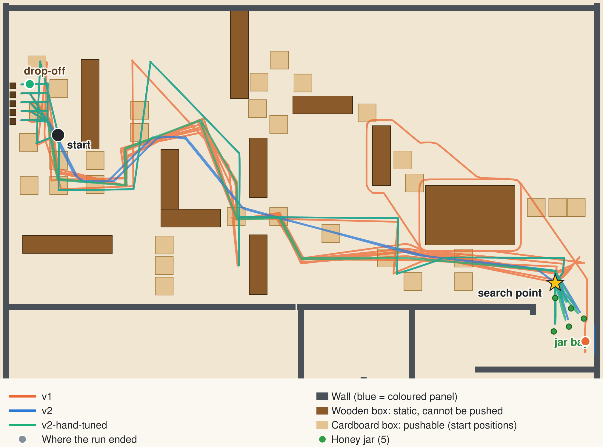

# Webots results

Both worlds run headless in Webots by `tools/run-in-webots.sh` on 2026-11-06, each with a 1500 s simulated-time limit. An observer supervisor judges both runs the same way: a jar counts as delivered once it rests in the drop-off lane for 5 s.

| | v1 | v2 | v2-hand-tuned |
|---|---|---|---|
| Jars delivered | 0/5 | 5/5 | 5/5 |
| Jars the controller says it delivered | 4 | 5 | 5 |
| Mission time (last jar delivered) | did not finish (stopped at 1500 s (25.0 min)) | 738 s (12.3 min) | 827 s (13.8 min) |
| Jar delivery times (s) | - | 177, 311, 446, 584, 738 | 189, 342, 499, 658, 827 |
| Stuck in one place from | 1204 s to the end | - | - |
| Distance driven | 281 m | 247 m | 276 m |
| Jars knocked out of the drop-off lane afterwards | 0 | 0 | 0 |
| Approach aborted | 7 | 0 | 0 |
| Full scan saw no jar | 0 | 0 | 0 |
| Whole search failed | 1 | 0 | 0 |
| Drive stalled or timed out (v2 detects these; v1 cannot) | 0 | 0 | 0 |

